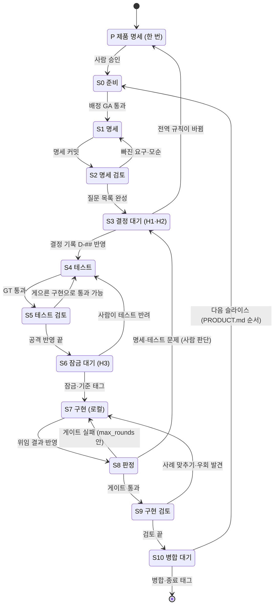

# 클라우드 세션에서 SDD 슬라이스 진행하기

클라우드 세션(예: Claude Code 클라우드)에서 이 하네스로 만든 프로젝트를 SDD(명세 → 테스트 → 구현 → 판정)로 진행하는 방법. 슬라이스 생명주기는 **유한 상태 기계**다: 상태마다 누가 · 어디서 · 무엇을 만들고, 어떤 조건에서 다음 상태로 넘어가는지 정해져 있다. 흐름의 근거는 `docs/slice-lifecycle.md` · `docs/sdd-integration.md`, 사람 구간은 `docs/human-zones.md`.

## 1. 전제

| 항목 | 내용 |
|:---|:---|
| 공유 | 장소(클라우드 · 로컬 · 다른 에이전트)는 **GitHub 브랜치로만** 이어진다. 슬라이스마다 `slice/<ID>`, 상태가 바뀔 때마다 커밋 · push |
| 이어 가기 | 세션은 매번 처음부터 시작한다. 첫 일은 `docs/HANDOFF.md` 읽기 + `git log` 로 지금 상태 확인. 세션 메모 · 대화 기억은 장소 사이에 공유되지 않는다 |
| 역할 | `config/assignments.toml` 의 슬라이스 배정이 정본 (`python harness/roles.py --preset <이름> --slice <ID>` 또는 `--ask`, 사람이 실행). 세션의 에이전트는 **자기 역할의 쓰기 경로만** 바꾼다 (G0 가 검사) |
| 판정 | 게이트(`python harness/run_gates.py`)만. 에이전트 보고는 판정이 아니다 |
| KPI | 사람에게 넘길 때 `python harness/mark.py wait-start <구간> --wo <ID>`, 답을 받은 직후 `wait-end ... --decisions N`. `reports/events.jsonl` 은 커밋 |

## 2. 상태 기계

| 상태 | 누가 (codex-lead 기준) | 장소 | 산출물 · 커밋 | 다음으로 넘어가는 조건 |
|:---|:---|:---|:---|:---|
| P 제품 명세 | lead 초안 → **사람** 승인 | 클라우드 | `docs/PRODUCT.md` (목적 · 대상 · 범위 밖, 용어 · 도메인 모델, 전역 불변식 INV-G#, 기능 목록 · 슬라이스 순서). 얕게 — 자세한 것은 슬라이스에서 | 사람이 `상태: 승인됨` 으로 바꿈 (`wait-start DEC`) |
| S0 준비 | 사람 | 어디든 | `slice/<ID>` 브랜치, 배정 (`roles.py`), 범위 = `PRODUCT.md` 4절의 다음 슬라이스. **위험도 프로필**(사람이 낮음 · 보통 · 높음 중 선택, 손잡이 3개: S5 검토 예산(회차), 승격 엄격도, 변이 분류(높음일 때만). 핵심 유스케이스는 마이크로 테스트, 세부 경계는 슬라이스 끝에 묶어 추가) | `python harness/check_assignments.py` 통과 |
| S1 명세 | lead (spec_author) | 클라우드 | `specs/<###-기능>/spec.md`, 가정 · 명료화 답은 `→ [결정 대기]`. 사람이 실제 원문 · 거친 예시 1 ~ 2개를 `specs/<기능>/samples/original-*` 로 준다. lead 는 이를 바탕으로 파생 표본 3 ~ 5개(`derived-*`)를 만들어 사람 확인을 받는다. **승격 근거 ① 은 원문만** (파생은 테스트에만) | 명세 커밋 · push |
| S2 명세 검토 (위험도별 선택) | 품질 검토자 (adversary) | 클라우드 | **선택 단계**: 위험도 low 는 생략할 수 있고 적합도 카드에 생략을 적는다, medium 이상은 S5 와 한 회차로 묶어 할 수 있다(생략 · 묶음이면 S1 → S3). `reports/review/<ID>-spec.md`. 데이터 오염 · 상태 전이 파괴 등 실제 피해를 내는 결함 판단, 승격 규칙에 맞지 않는 코너 케이스는 스스로 기각(근거 = 규칙), 검토 예산(위험도 프로필) 안에서 피해 시나리오와 해결 방향("테스트 추가" 또는 "명세 관리")을 함께 제시 (`reviewer` 는 배정하지 않는다) | S1 clarify 질문과 S2 검토 질문을 묶은 통합 질문 목록 모임 (빠진 요구는 S1 로) |
| S3 결정 대기 | **사람** | — | `reports/decisions.md` D-##, 명세의 `→ [결정 대기]` 를 `→ D-##` / `→ H#`. S3 질문 묶음과 함께 **적합도 카드**(`templates/sdd/spec-fitness-card.md`)를 사람에게 제공: 핵심 흐름 목록, 계약 안 경계와 승격 근거, 계약 밖 목록 (GT 참고의 개수), 예상 테스트 수, 위험도 프로필. 새 멈춤을 만들지 않는다. **옵트아웃**: 위험도 low · medium 슬라이스는 질문을 추천 · 근거 1줄 · 대안 1줄 패키지(`templates/sdd/clarify-package.md`)로 보여 사람이 "OK" 로 일괄 승인할 수 있다 — `harness/decisions.py expand` 가 질문마다 D-## 로 원문 전개, GT `batch_integrity` 가 확인. H# 로 가는 질문은 하나씩 | S1 clarify 질문과 S2 질문을 묶어 한 번에 답함 (`wait-end`) |
| S4 테스트 | lead (test_author) | 클라우드 | `tests/**` (머리말 `guards` · `technique` · `checklist`), `work_orders/<ID>.md` (지시서는 test_author 가 `work_orders/**` 에 쓴다) | GT 통과 (`run_gates.py` 의 GT) |
| S5 테스트 검토 | 품질 검토자 (adversary) | 클라우드 | `reports/review/<ID>-tests.md`. 검토 예산(위험도 프로필) 안에서 피해 시나리오와 해결 방향 동봉. 예산 안에서 계약 안 피해 결함이 새로 나오지 않는 회차가 나오면 종료, 예산을 넘긴 발견은 다음 슬라이스 목록으로 | 받아들인 공격이 테스트에 반영됨 |
| S6 잠금 대기 | **사람** → lead | 어디든 | 사람 H3 승인(또는 프로젝트 결정이 허용한 자동 승인 조건을 모두 채우면 `mark.py auto-approve` 기록, 위험도 high 제외; 제품 코드를 바꾸지 않고 테스트만 추가했으면 `mark.py auto-approve additive`(조건은 slice-lifecycle 참고)) → lead 잠금(`check_protected_paths.py --write-lock`) · 커밋 · 기준 태그 `<ID>-base`(위임 전, 기존 태그 이동 · 삭제 금지), 지시서 확정(`work_orders/<ID>.md`) | 잠금 + 지시서 확정 커밋 = 기준 태그 `<ID>-base` |
| S7 구현 | implementer (AGY) | **로컬만** | 격리 작업 공간 → `src/**` diff. 위임 도구가 편집 뒤 지시서 `feedback` 명령을 돌려 결과(`reports/feedback_report.json`)를 에이전트에게 돌려주는 루프 (내부 반복 상한, 예: 3). 에이전트에게 명령 권한은 주지 않는다 (HD-09). 커버리지(G3)는 피드백에 넣지 않는다 (구현자가 분기를 지우게 한다). 반복 수는 위임 기록에 남기고 하네스 KPI 는 `config/delegation.toml` 의 `feedback_key` 로 읽는다 | 결과를 브랜치에 반영 · push |
| S8 판정 | lead | 클라우드 · 로컬 | `run_gates.py --role implementer --base <ID>-base --slice <ID> --wo <ID>` + diff 읽기 | 게이트 통과 |
| S9 구현 검토 | 품질 검토자 (adversary) | 클라우드 | `reports/review/<ID>-impl.md` | 뚫림 없음 (있으면 S7) |
| S10 병합 대기 | **사람** (lead) | 어디든 | `templates/slice-closure.md`. 종료 태그는 H9 대상이 없으면 lead, 병합 · push 는 사람 | 종료 태그 `<ID>-closed`, 병합 · push |

- 사람 상태(P · S3 · S6 · S10)에서만 멈춘다.
- 슬라이스 명세는 관련된 전역 불변식(INV-G#)을 그대로 인용한다. 슬라이스 결정(S3)이 전역 규칙을 바꾸면 P 로 돌아가 `PRODUCT.md` 를 고치고 영향받는 슬라이스를 적는다. S1 의 clarify 질문은 S2 질문과 **묶어 한 번에** 사람에게 묻는다(S3) (명세 단계 사람 멈춤 5 → 1 = KPI).
- 되돌아가는 전이는 이유를 `reports/spec_issues.md` 에 한 줄 남긴다.
- 진행 상태 문서(`docs/HANDOFF.md` 의 `상태:`)는 **lead 만, 판정 구간 밖에서**(기준 태그 전 또는 판정 뒤) 갱신한다. 다른 역할은 자기 산출물 커밋까지만 하고 상태를 바꾸지 않는다 (역할 판정 구간 안의 lead 커밋은 그 역할의 G0 위반으로 집계되기 때문이다).
- 단계 사이 전달 (HD-22): 단계 간 전달은 ① 알림 (완료 커밋 · 다음 역할을 사람에게) → ② 준비 (작업 공간 · 커밋 · 승인 확인까지, 실행 직전 멈춤) 순서로 한다. 자동 실행은 하지 않는다. 신호에는 자유 문장이 아니라 작업 ID · 커밋만 담는다.

## 3. 클라우드 세션 시작 절차

1. 저장소를 연결하고 `slice/<ID>` 브랜치에서 시작 (없으면 사람이 S0).
2. `docs/HANDOFF.md` 의 `상태:` 와 `AGENTS.md` / `CLAUDE.md` 의 역할 구간을 읽는다.
3. 도구: `python adapters/python/setup_env.py --dry-run` 으로 계획 확인 뒤 실제 실행(선택 `--speckit <연동>`), 단계 순서와 “재생성” 표시 확인. Spec Kit 이 필요하면 **최소 버전 v1.1.3**(`uv tool install "specify-cli>=1.1.3"` 계열)을 설치한다(네트워크 허용 시). 비대화형 명령은 `specify init --here --integration <에이전트> --non-interactive` 류를 사용하며, 확실하지 않은 인자는 버전 문서를 확인한다. S1 의 clarify 질문은 개별 질의하지 않고 S2 질문과 **묶어 한 번에** 사람에게 묻는다(S3).
4. 자기 역할의 상태 일만 하고 커밋 · push. 진행 상태 문서(`docs/HANDOFF.md` 의 `상태:`)는 **lead 만, 판정 구간 밖에서**(기준 태그 전 또는 판정 뒤) 갱신한다 (다른 역할은 상태를 바꾸지 않는다. 이유: 역할 판정 구간 안의 lead 커밋은 그 역할의 G0 위반으로 집계된다).

## 4. lead 가 Codex 이고 세션이 Claude 클라우드일 때

| 고려할 것 | 이유 · 방법 |
|:---|:---|
| **세션의 주인 = 그 에이전트** | Claude 클라우드 세션에서 돌아가는 것은 Claude 다. Codex 를 lead 로 쓰려면 Codex 는 자기 환경(Codex 클라우드 · CLI)에서 돌고, Claude 세션은 **품질 검토자(adversary: S2 · S5 · S9)만** 맡는다. 둘은 브랜치로만 만난다 |
| Claude 세션이 lead 일을 대신하지 않기 | 명세 · 테스트를 Claude 가 쓰면 test_author = adversary 가 같은 계열이 되어 분리 규칙이 깨진다 (GA 는 배정만 보므로 커밋 작성자를 따로 확인). 필요하면 S0 에서 `claude-lead` 프리셋으로 **배정 자체를 바꾼다** (슬라이스 경계에서만) |
| 차례 표시 | 두 에이전트가 같은 브랜치를 동시에 쓰지 않게, HANDOFF `상태:` 가 차례다. 진행 상태 문서(`docs/HANDOFF.md` 의 `상태:`)는 **lead 만, 판정 구간 밖에서** 갱신한다. 다른 역할은 자기 산출물 커밋까지만 하고 상태를 바꾸지 않는다 (역할 판정 구간 안의 lead 커밋은 그 역할의 G0 위반으로 집계된다). 자기 상태가 아니면 읽기만. 다른 역할(예: `doc_editor`)이 HANDOFF 를 고친 뒤에는 `python adapters/tools/check_handoff_state.py --base <편집 전 커밋>` 으로 `상태:` 줄이 그대로인지 확인한다 |
| 구현(S7)은 로컬 | AGY 는 로컬 CLI. 클라우드에서는 S7 을 건너뛰고 사람/로컬 세션에 넘긴다 |
| 계열 기록 | 위임 결과의 실제 계열을 지시서 `family` 로 (또는 `config/delegation.toml` + `job`). 로컬 위임 기록(`.jobs/`)은 커밋하지 않으므로 클라우드 판정에서는 `family` 를 적는 쪽이 안전 |
| 비밀 · 네트워크 | 클라우드 세션에 API 키를 두지 않는다. 네트워크가 막히면 설치 단계(S0 · 도구)를 로컬에서 |

## 5. 하네스와의 경계

하네스 결함은 프로젝트에서 고치지 않는다 → `docs/harness-sync.md` 3절.
