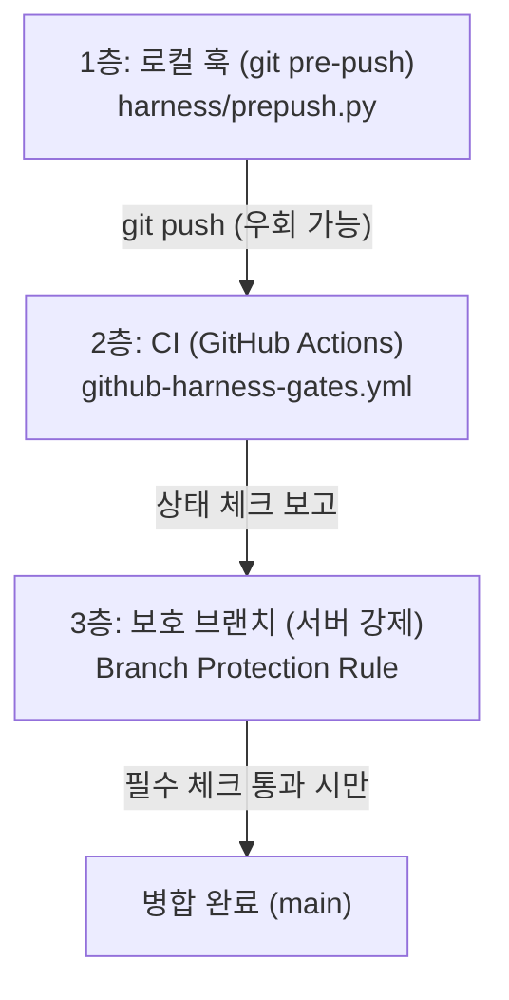

# 병합 강제 및 판정 증거 계약 (HD-28 0a)

이 문서는 TDD 하네스의 품질 게이트를 실제 저장소 병합 단계에 강제하기 위한 세 층의 방어 체계와 운영 규칙을 설명한다.

---

## 1. 세 층의 방어 체계와 각자 막는 것

병합 강제는 로컬 개발 환경부터 원격 저장소 보호까지 총 세 층으로 구성된다.



| 층 | 위치 및 도구 | 주요 역할 및 막는 위협 |
|:---|:---|:---|
| **1층: 로컬 훅** | 로컬 개발 환경 (`.git/hooks/pre-push`, `harness/prepush.py`) | - 작업 트리가 깨끗하지 않은 상태(`dirty`)에서의 push 차단 (`reports/` 제외)<br/>- 현재 HEAD 와 일치하지 않는 커밋 push 차단<br/>- 보호 브랜치(`protected_refs`)의 삭제 차단<br/>- 로컬에 없는 원격 커밋 push 시도 차단 ("먼저 fetch")<br/>- 게이트 실패 시 push 차단으로 빠른 로컬 피드백 제공 |
| **2층: CI (지속적 통합)** | 격리된 CI 러너 (`templates/ci/github-harness-gates.yml`) | - 개발자의 로컬 작업 트리 변경을 가져오지 않은 새 체크아웃에서 게이트 재실행 (판정 코드·설정은 대상 커밋의 것)<br/>- PR 및 push 대상 커밋에 대해 기준 커밋 대비 전체 이력 및 규칙 검증<br/>- `harness/evidence.py check` 를 통해 생성된 증거 객체 대조 |
| **3층: 보호 브랜치** | 원격 저장소 서버 (GitHub Branch Protection Rules) | - CI 의 품질 게이트 체크 통과를 병합의 **필수** 조건으로 강제<br/>- 보호 브랜치로의 직접 push 및 force-push 차단<br/>- PR 리뷰 및 게이트 통과 없는 임의 병합 차단 |

---

## 2. 로컬 훅의 한계와 서버 강제의 필요성

> [!WARNING]
> 로컬 git 훅은 보안 경계가 아니며, 강제의 최종 수단이 될 수 없습니다.

- 로컬 훅(`harness/prepush.py`)은 개발자의 실수나 부주의로 인한 결함 유입을 로컬에서 미리 막아주는 편의성 도구입니다.
- 개발자는 언제든지 `--no-verify` 플래그를 사용하여 훅을 건너뛸 수 있습니다:
  ```bash
  git push --no-verify origin main
  ```
- 또한 로컬 훅 파일(`.git/hooks/pre-push`)은 저장소 클론 시 자동으로 복사되지 않으므로, 설치 명령(`python harness/prepush.py --install`)을 실행하지 않은 환경에서는 동작하지 않습니다.
- 따라서 진정한 의미의 **실제 병합 강제**는 개발자가 우회할 수 없는 **서버 쪽 보호 브랜치의 필수 상태 체크(Required Status Checks)** 에 의해 완성됩니다.

---

## 3. 판정 증거 대조 (`evidence.py`) 의 표시 · 대조용 한계

`harness/evidence.py check --sha <rev>` 명령은 보고서(`reports/gate_report.json`) 내의 `evidence` 객체를 검증합니다:

1. `schema` = 1 (정수)
2. `target_sha` = 지정한 커밋의 전체 해시
3. `scope` = `"full"` (전체 게이트 실행 증거만 인정)
4. `dirty` = false (불리언, 작업 트리가 깨끗한 상태에서 실행됨)
5. `exit_code` = 0 (정수, 게이트가 성공적으로 통과함)

`--only` 실행(`PARTIAL PASS`, scope: `{"only": [...]}`)이나 `--slice` 실행(`SLICE PASS`, scope: `{"slice": ...}`)과 같은 부분 실행은 전체 통과 증거가 아니므로 `evidence.py check` 에서 거부(1)됩니다.

> [!IMPORTANT]
> 로컬 환경의 보고서 파일은 일반 JSON 텍스트이므로 얼마든지 위조하거나 사후 편집할 수 있습니다.
> 따라서 `evidence.py check` 는 **표시 · 대조용** 검사이며, 실제 독립된 게이트 판정(`run_gates.py`)을 대신하지 않습니다.
> CI 환경에서는 반드시 게이트를 직접 실행한 직후에 산출된 보고서와 커밋 해시를 대조하는 방식으로 사용해야 합니다.

이 검사는 보고서에 기록된 시점의 위 다섯 항목을 대조합니다. 역할·기준 커밋·게이트 집합의 적합성, 현재 작업 트리 상태와 가장 최근 실행의 보고서 신선도까지 확인하는 검사는 아닙니다. CI도 대상 커밋의 판정 코드·설정을 사용하므로, 이 템플릿 자체가 판정 코드 변경에 대한 별도 신뢰 경계를 제공하지 않습니다.

---

## 4. GitHub 보호 브랜치에서 필수 체크(Required Status Check) 설정 방법

원격 저장소에서 하네스 게이트 통과를 필수화하려면 다음 절차를 진행합니다:

1. 저장소 관리자 권한으로 GitHub 저장소에 접속합니다.
2. **Settings** → **Branches** 로 이동합니다.
3. **Branch protection rules** 섹션에서 **Add rule** (또는 기존 `main` 룰 편집)을 클릭합니다.
4. **Branch name pattern** 에 `main` (또는 프로젝트의 보호 대상 브랜치 이름)을 입력합니다.
5. **Protect matching branches** 항목 아래에서:
   - `Require a pull request before merging` 체크
   - **`Require status checks to pass before merging`** 체크 (**필수**)
   - `Require branches to be up to date before merging` 체크
6. 나타나는 상태 체크 검색창에서 워크플로 잡 이름(예: `Run Harness Gates` 또는 `gates`)을 검색하여 **필수(Required)** 상태 체크로 등록합니다.
7. (선택 및 권장) **Do not allow bypassing the above settings** 항목을 체크하여 저장소 관리자라 할지라도 게이트를 우회하여 병합하지 못하도록 설정합니다.
8. **Create** 또는 **Save changes** 를 눌러 저장합니다.

이 설정이 완료되면, CI 에서 `run_gates.py` 와 `evidence.py check` 가 모두 통과하여 녹색 체크(Success)가 찍히지 않는 한 PR 을 `main` 브랜치에 병합할 수 없습니다.

---

## 5. 로컬 훅 설치 및 사용법

### 훅 설치
```bash
python harness/prepush.py --install
```
- `<git 저장소>/.git/hooks/pre-push` 에 실행 스크립트가 작성됩니다.
- 설치를 실행한 Python 인터프리터의 절대 경로가 기록되며, 저장소 루트는 훅 실행 시 Git으로 조회합니다.
- 기존에 하네스 표지(`# harness-pre-push-hook`)가 있는 훅은 안전하게 재설치(0)되며, 표지가 없는 타 도구의 훅이 있으면 덮어쓰지 않고 거부(1)합니다.

### 훅 동작 규칙 (`config/gates.toml`)
`config/gates.toml` 에 `[enforcement]` 설정이 있는 경우에만 동작합니다:
```toml
[enforcement]
protected_refs = ["refs/heads/main"]
role = "implementer"
```
- `[enforcement]` 가 없으면 안내 메시지 출력 후 정상 종료(0)하여 push 를 방해하지 않습니다.
- 보호 브랜치로 push 시 깨끗한 커밋과 작업 트리를 검증한 뒤 `run_gates.py` 를 실행합니다.

현재 훅은 작업 트리의 설정을 읽으므로 `[enforcement]`를 제거하면 검사를 생략합니다. 신규 보호 ref는 원격 기준 커밋이 없어 보낼 커밋 자체를 기준으로 게이트를 실행하며, 이 경우 G0의 커밋 차이 검사는 빈 diff입니다. 원격 기준 선택을 강화하는 별도 정책이 적용된 것으로 해석하지 않습니다.

설치 위치는 Git의 `core.hooksPath` 설정을 따릅니다. 공유 훅 경로에 설치하면 하네스가 없는 다른 저장소의 push에도 영향을 줄 수 있으므로 실제 설치 대상을 확인해야 합니다.

### 판정 증거 선택적 재사용 (`reuse_evidence`)

프로젝트가 선택하면, 이전 전체 게이트 통과 증거를 보호 ref의 push에서 다시 사용할 수 있습니다. 기본값은 끔입니다.

```toml
[enforcement]
reuse_evidence = true
```

재사용은 보호 줄마다 `reports/gate_report.json` 이 다음 조건을 모두 만족할 때만 적용됩니다: 보고서의 대상 커밋이 이번 push 대상 커밋과 같고, 해당 줄의 기준 커밋과 보고서의 기준 커밋이 같으며, 보고서 역할이 `[enforcement] role`과 같고, 증거 규격(`schema` 정수 1, `exit_code` 정수 0)을 만족하고, 전체 범위(`scope = full`)의 실행이며, 깨끗한 트리에서 실행되었고, `ALL PASS`이며, 보고서 최상위 `passed`가 불리언 `true`여야 합니다. 보호 ref 삭제, HEAD 불일치, 작업 트리 변경, 필요한 원격 커밋을 가져오지 않은 상태 등 사전 거부가 재사용 판단보다 먼저 적용됩니다. 조건 중 하나라도 맞지 않으면 해당 줄의 게이트를 다시 실행합니다. 보호 줄이 여럿이면 훅 시작 때 읽은 보고서로 판단하며, 앞 줄의 게이트 재실행으로 덮어쓴 보고서로 판단하지 않습니다. 보호 ref 로 push 할 때 설정값이 불리언이 아니면(정수 `0`·`1`이나 문자열 포함) 게이트를 돌리지 않고 push를 거부합니다.

로컬 보고서는 위조할 수 있고 구현자가 `reports/`에 쓸 수 있다는 위험을 받아들입니다. 1층 로컬 훅은 우회 가능한 편의 기능이며, 2층 CI는 새 체크아웃에서 게이트를 계속 새로 실행합니다. 이 기능을 켤지는 프로젝트의 선택입니다.
