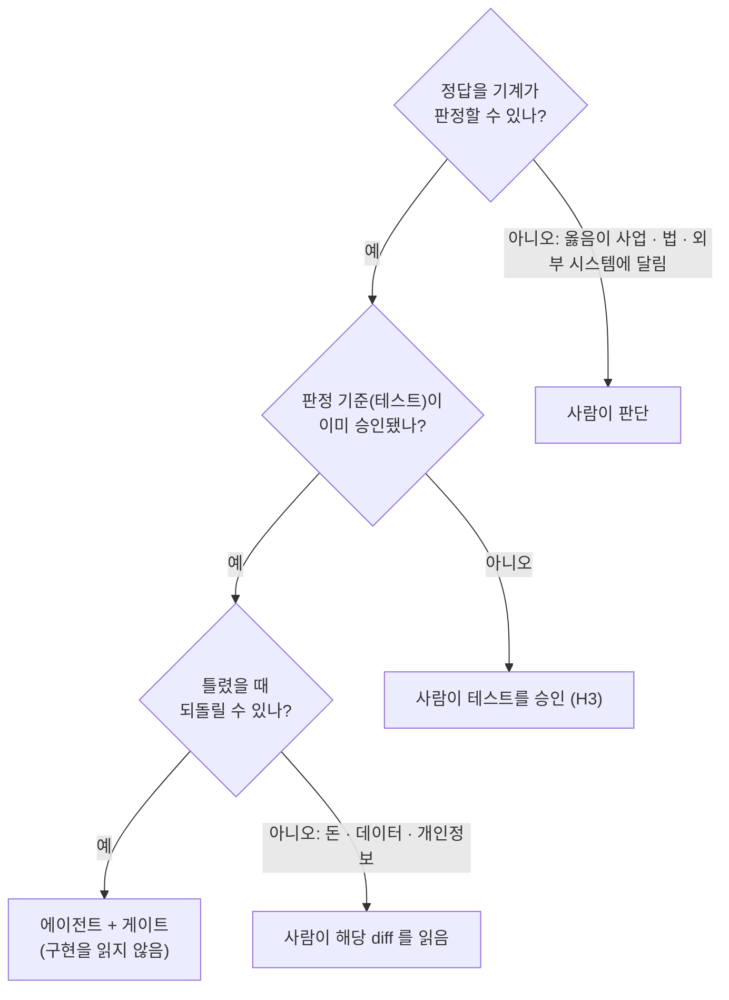

# 사람 판단 구간 (H1 ~ H11)

기준은 하나다. **정답을 기계가 판정할 수 없거나, 틀렸을 때 되돌릴 수 없는 곳**은 사람이 판단한다. 그 밖은 에이전트 + 게이트에 맡기고 사람은 구현을 읽지 않는다.

## 1. 판단 기준

## 2. 구간

| ID | 구간 | 사람이 하는 일 | 왜 기계에 맡길 수 없나 | 읽는 대상 | 빈도 |
|:---|:---|:---|:---|:---|:---|
| **H1** | 불변식 · 정책 정의 | 불변식 표, 정책 규칙, 상태 기계를 쓴다 | "옳다"의 정의는 사업에서 온다. 에이전트가 만들면 그럴듯한 추측이 명세가 된다 | 도메인 모델 문서 | 핵심 |
| **H2** | 경계값 · 값 선언 | 승격된 경계의 값 · 소속만 사람이 정한다 (단위 · 범위 · 정밀도 · 검증 위치 포함, C-A3). 근거 없는 저수준 경계는 계약 밖으로 분류되며 사람에게 묻지 않는다 | 논리로 유도되지 않는 선택이다. 테스트는 선택을 기록할 뿐 정당화하지 못한다 | 결정 기록 | 핵심 |
| **H3** | 테스트 승인 | 테스트가 원하는 것인지 판단하고 잠근다 | 테스트가 곧 명세다. 테스트가 틀리면 모든 초록불이 거짓이다 | 테스트, H3 승인 자료 | 핵심 |
| **H4** | 포트 · 계약 설계 | 포트 메서드와 의미(원자성, 멱등성, 복사)를 정한다 | 나중에 바꾸면 Fake, 계약 테스트, 유스케이스 테스트가 모두 바뀐다 | 포트 정의, 계약 문서 | 조건부 |
| **H5** | 동시성 · 트랜잭션 | 구조적 보증(제약 · 격리 수준)이 있는지 확인한다 | 동시성 테스트는 확률적이다. 통과는 "이번에 못 찾음"일 뿐이다. 보증은 구조에서 온다 | 스키마 · 마이그레이션 | 조건부 |
| **H6** | 외부 시스템 연동 | 외부 문서와 실제 동작 차이, 재전송 정책, 대사를 확인한다 | 오라클이 외부에 있다. 시험 환경과 운영이 다를 수 있다 | 외부 연동 어댑터 | 조건부 |
| **H7** | 보안 · 개인정보 | 위협 모델을 쓰고 "일어나면 안 되는 일" 목록을 늘린다 | 테스트는 생각해 낸 위협만 검사한다 | 위협 모델, 로그 설정 | 조건부 |
| **H8** | 데이터 마이그레이션 | 기존 데이터에 대한 변경을 검토한다 | 되돌릴 수 없다. 테스트 데이터는 운영의 이상한 과거 행을 갖고 있지 않다 | 마이그레이션 | 조건부 |
| **H9** | 생존 변이 판정 | 등가 변이인지, 테스트가 빠진 것인지 판단한다. 반복 유형은 등가 규칙으로 결정 | 두 프로그램의 동작이 같은지는 일반적으로 결정 불가능하다 | 변이 결과, 분류 보고서 | 조건부 |
| **H10** | 하네스 · 게이트 변경 | 임계값, 우회 패턴, 역할 권한, 실행 환경을 고친다 | 감시자를 감시하는 자리다. 에이전트가 고치면 제약이 제약이 아니게 된다 | 하네스 설정 · 코드 | 드묾 |
| **H11** | 운영 관측 · 사고 대응 | 운영 지표의 이상을 본다 | 운영에서만 드러나는 결함은 명세 밖에 있었던 것이다. 새 불변식으로 바꾸는 것이 H1로 돌아가는 고리다 | 운영 지표 | 개발 루프 밖 |

**기능 하나당 고정 개입은 결정(H1 · H2)과 승인(H3)이다.** 조건부 구간은 해당 경로(`review_required`)를 건드리거나 등가 의심 변이가 나올 때만 열린다.

## 3. 사람이 읽지 않는 것 (그리고 그래도 되는 이유)

| 읽지 않는 것 | 대신 신뢰하는 것 |
|:---|:---|
| 순수 로직 구현 | 성질 테스트 + 독립 오라클 + 전수 표 + 변이 점수 + 분기 커버리지 |
| 유스케이스 구현 | Fake + Spy 테스트 (횟수) + 인수 시나리오 + 변이 |
| 어댑터의 매핑 코드 | 실제 자원에 돌린 계약 테스트 |
| 표현 계층 (판단 없는 얇은 층) | 판단이 없다는 구조 규칙 + 탐색 QA |
| 리팩터링 커밋 | 모든 게이트 재통과 + 복잡도 상한 |

읽는 양이 0이 되는 것이 아니라 **읽는 대상이 구현에서 테스트로** 바뀐다.

## 4. 사람 시간 기록 (`harness mark`)

| 규칙 | 내용 |
|:---|:---|
| **start / end는 H 단계 판단 동안만** | 읽기 · 판단을 시작할 때 `harness mark start <H 구간> --slice <슬라이스 ID>`, 판단이 끝난 직후 `end`. H3이면 **잠금 직후** end |
| 넣지 않는 것 | 에이전트 작업 시간, 게이트 실행 대기, 사람이 다른 일을 하는 시간 |
| 시각은 명령이 찍는다 | 사람이 시각을 직접 적지 않는다. 지난 시각은 받지 않는다 (기억에 의존한 사후 기록 방지) |
| 빠뜨렸으면 비워 둔다 | 기억으로 채우지 않는다. 종료 기록에 "기록 없음" |
| 메모 | `harness mark note "<내용>" --slice <슬라이스 ID>` |
| 보조 지표 | 핵심 KPI(판정 수, 리드타임, G0 위반)는 자동 이벤트에서 계산한다. mark 기록은 "사람 시간"에만 쓴다 |
| **자동 대기 기록** | lead 가 멈출 때 `wait-start <구간> --wo <ID>`, 답을 받은 직후 `wait-end <구간> --wo <ID> --decisions N` (값은 사람 시간의 상한) |

## 5. 잠금 규칙 (`harness lock`)

| 규칙 | 내용 |
|:---|:---|
| **잠금은 테스트나 명세가 바뀌었을 때만** | 보고서 · 결정 기록 · 지시서만 바뀌면 재잠금하지 않는다 |
| 테스트나 명세가 바뀌면 반드시 | H3 재승인 → 재잠금. 재승인 사유를 문제 기록과 H3 자료 §6에 |
| 잠금 방식이 바뀌면 | (예: 해시 정규화 변경) 사람이 재잠금한다. 테스트 내용이 승인 이후 바뀌지 않았다는 근거(`git diff <승인 커밋> -- <테스트 경로>`가 비어 있음)를 함께 적는다 |
| 잠그는 곳 | main에만. 격리 저장소에서는 잠그지 않는다 |

## 6. 구간별 질문 (H3 외)

H3 질문은 `templates/checklist.md`.

| 구간 | 질문 |
|:---|:---|
| H4 포트 변경 | 원자성 · 멱등성 · 예외 조건이 계약 문서에 있는가? 계약 테스트가 새 계약을 검사하는가? Fake가 새 계약을 따르도록 바뀌었는가(테스트 작성자의 일)? 바뀌어야 하는 유스케이스 테스트 목록을 아는가? |
| H5 · H8 스키마 · 마이그레이션 | 불변식을 구조(제약)로 보증하는가? 되돌리기 절차가 있거나 되돌릴 수 없다고 명시했는가? 운영 데이터 크기에서의 잠금 시간을 추정했는가? 기존 데이터가 새 제약을 위반하지 않는지 먼저 확인했는가? |
| H6 외부 연동 | 재전송 정책(횟수 · 간격 · 순서)을 확인했는가? 요청 · 응답의 위조를 검증하는가? 멱등 키가 외부에 실제로 전달되는가? 시험 환경과 운영의 차이 목록이 있는가? |
| H10 하네스 변경 | 임계값을 **내리는** 변경인가(근거)? 우회 패턴을 **지우는** 변경인가(더 좁은 패턴으로 대체했나)? 역할 권한을 넓히는가(왜)? 변경 전후로 같은 입력에 게이트를 돌려 차이를 확인했는가? 게으른 후보 회귀(test-design 10)가 여전히 기대와 일치하는가? |
| 매 병합 | 판정 결과가 에이전트 환경이 아닌 세션 밖 실행에서 나왔는가? 에이전트 보고와 게이트 결과가 다르면 그 차이를 기록했는가? `review_required` 경로의 diff를 읽었는가? |
