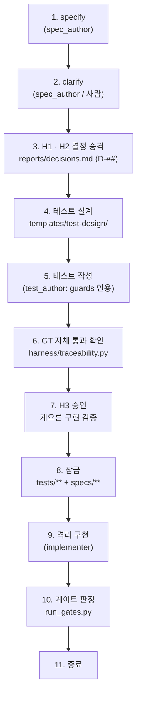

# SDD(명세 주도 개발) 통합 지침

이 문서는 Spec Kit(`specify`, `clarify`)을 TDD 하네스(`agent-harness`) 앞에 연동하여 명세부터 테스트, 구현, 판정까지 이어지는 개발 절차를 정의한다.

## 1. 대원칙 및 권위 순서

- **TDD 가 우선이다**: Spec Kit 은 자연어 명세의 편의를 돕는 도구일 뿐이며, 명세의 의미적 정확성을 보증하지 않는다.
- **판정의 독립성**: 판정은 오직 하네스 게이트(`python harness/run_gates.py`)만이 수행한다. Spec Kit 워크플로의 자체 훅이나 에이전트의 보고는 판정에 쓰지 않는다.
- **권위 순서 (Hierarchy of Authority)**:
  **잠긴 테스트 > 결정(D-##) > 불변식(INV-#) > 명세 산문**
- **충돌 해결**: 명세 산문과 잠긴 테스트가 다르면 무조건 **테스트가 이긴다**. 요구사항을 변경하려면 `새 D-## 선언 → 테스트 수정 → H3 재승인 · 재잠금` 절차를 거친다. 기존 D는 수정하지 않고 새 번호로 대체한다(append-only).

---

## 2. 전체 흐름



| 단계 | 주체 | 행동 | 핵심 산출물 및 규칙 |
|:---|:---|:---|:---|
| 1. 명세 초안 | `spec_author` | `specify` 명령 실행 | `specs/<기능>/spec.md` 생성, Invariants 및 Boundary tables 작성 |
| 2. 모호성 해소 | `spec_author` | `clarify` 명령 실행 | 질문/답변 기록, 답변 줄에 `→ [결정 대기]` 표기 |
| 3. 결정 승격 | 사람 (H1 · H2) | 가정 · 명확화 승격 | `reports/decisions.md` 에 `D-##` 기록, 명세의 미결정 칸 갱신 |
| 4. 테스트 설계 | `test_author` | 설계 템플릿 참조 | `templates/test-design/` 기법 선정, 체크리스트 C-A 확인 |
| 5. 테스트 작성 | `test_author` | 테스트 모듈 작성 | 모듈 머리말 `guards` 에 `FR-###`, `INV-#`, `D-##` 인용 |
| 6. GT 검사 | `test_author` | 추적성 게이트 확인 | GT 통과 확인 (명세 요구 ↔ 테스트 양방향 일치) |
| 7. H3 승인 | 사람 | 테스트 승인 | `templates/h3-approval.md`, 가장 게으른 구현 차단 확인 |
| 8. 잠금 | 사람 | 파일 잠금 | `tests/**` 및 `specs/**` 잠금 해시 갱신, 기준 태그 생성 |
| 9. 격리 구현 | `implementer` | 제품 코드 작성 | 격리된 환경에서 `src/**` 만 수정 |
| 10. 게이트 판정 | 하네스 (lead) | 전체/슬라이스 게이트 | `python harness/run_gates.py` 로 기계적 판정 |
| 11. 종료 | 사람 | 슬라이스 종료 | 변이 분류(H9) 및 종료 태그 생성 |

---

## 3. Spec Kit 명령별 하네스 사용 정책

| 명령 | 사용 여부 | 역할 및 하네스 정책 |
|:---|:---|:---|
| `specify` | **사용** | 명세 초안 작성. Invariants, Boundary tables 필수 작성. 가정에 `→ [결정 대기]` 표기 |
| `clarify` | **사용** | 요구 모호성 해소. 답변 줄에 `→ [결정 대기]` 표기. Boundary tables 동기화 |
| `plan` | **선택** | 구현 참고 및 조언용. 하네스 게이트 판정에는 쓰지 않음 |
| `tasks` | **선택** | 작업 분해 참고용. 하네스 게이트 판정에는 쓰지 않음 |
| `implement` | **금지** | 하네스 판정에 쓰지 않음(E7). 격리 위임(`docs/isolated-delegation.md`)으로 대체 |
| `analyze` | **금지** | 하네스 판정에 쓰지 않음(E7). 하네스 게이트(G0 ~ G7)가 대신 판정 |
| `converge` | **금지** | 하네스 판정에 쓰지 않음(E7). 게이트 실패 귀속 절차를 따름 |
| `constitution` | **차단** | preset 이 replace 로 차단. 하네스 생성기(`constitution.py --write`)로만 작성 |
| `checklist` | **선택** | 보조 확인용 |

---

## 4. 역할 및 쓰기 권한 (`config/roles.toml`)

명세 작성자, 테스트 작성자, 구현자를 엄격히 분리하여 자기 편향과 맹점을 차단한다.

| 역할 | 허용 경로 (`allow`) | 금지 경로 (`deny`) | 특이 사항 |
|:---|:---|:---|:---|
| `spec_author` | `specs/**`, `.specify/feature.json`, `.specify/workflows/runs/**`, `reports/**` | `src/**`, `tests/**`, `harness/**`, `adapters/**`, `templates/**`, `config/**`, `.specify/memory/**` | `lock_exempt = true` (첫 잠금 전 작업, HD-01) |
| `test_author` | `tests/**`, `reports/**` | `src/**`, `specs/**`, `.specify/**`, `harness/**`, `adapters/**`, `templates/**`, `config/**` | 테스트 작성 전용 |
| `implementer` | `src/**`, `reports/**` | `tests/**`, `specs/**`, `.specify/**`, `harness/**`, `adapters/**`, `config/**` | 잠긴 테스트와 명세는 읽기 전용 |

> **`lock_exempt = true` 의 의미 (HD-01)**:
> `spec_author` 는 H3 에서 테스트와 명세가 처음 잠기기 전에 일한다. 그래서 자기 판정의 잠금 검사(G0)에서 빠진다. 잠금 뒤 명세를 고치면 **다음 구현자 판정의 잠금 검사가 실패**한다 (`check_g0_spec_cases.py` S04). 잠금 뒤 명세 변경은 새 D-## → H3 재승인 · 재잠금으로만 한다.

---

## 5. GT (추적성 게이트) 메시지별 대처법

`harness/traceability.py` 가 출력하는 위반 메시지 머리말별 원인과 해결 방법:

| 메시지 머리 | 뜻과 원인 | 누가 고치나 | 대처 방법 |
|:---|:---|:---|:---|
| `[머리말]` | 테스트 모듈 첫머리에 필수 키(`guards`, `technique`, `checklist`) 누락 | `test_author` | 테스트 모듈 상단 문서 문자열에 규약(`HEADER_CONVENTION.md`)대로 키 추가 |
| `[ID]` | `guards` 에 열린 질문(`O-##`) 인용 또는 비정규 ID 형식 | `test_author` | 열린 질문은 테스트할 수 없다. 사람이 D-## 로 결정한 후 인용하거나 ID 형식 수정 |
| `[미결정]` | 테스트 파일에 미결정 표시(`[사람 결정` 등)가 남아 있음 | `test_author` | 임시 값을 확정된 D-## 상수로 대체하고 표시 문자열 제거 |
| `[정방향]` | 명세에 정의된 FR 이 어떤 테스트의 `guards` 에도 없음 | `test_author` | 해당 FR 을 검증하는 테스트를 작성하고 `guards` 에 추가 (또는 슬라이스 `deferred` 등록) |
| `[역방향]` | tests 의 `guards` 에 적힌 ID 가 명세나 결정 기록에 없음 | `test_author` | 오타 수정 또는 `spec_author`/사람에게 해당 FR/INV/D 정의 요청 |
| `[가정]` | `## Assumptions` 항목에 승격 표시(`→ D-##`, `→ H#`)가 없거나 D 가 결정 기록에 없음 | 사람 / `spec_author` | 항목 끝에 승격 표시 추가. D-## 인 경우 `reports/decisions.md` 에 정의 |
| `[명확화]` | `## Clarifications` 답변 줄이 `→ D-##` / `→ H#` 로 끝나지 않거나 D 가 결정 기록에 없음 | 사람 / `spec_author` | 사람이 `reports/decisions.md` 에 기록하고 `→ D-##` 로, 또는 사람 구간으로 정하면 `→ H#` 로 바꾼다 |
| `[명확화 필요]` | 명세 본문에 `[NEEDS CLARIFICATION]` 마커 잔존 | `spec_author` | `clarify` 세션을 통해 모호성을 해소하고 마커를 확정 답변으로 교체 |
| `[중복 정의]` | 같은 FR · INV · D 가 정의 줄로 두 번 이상 나옴 (뜻이 둘이면 테스트가 어느 쪽을 지키는지 모른다) | 사람 / `spec_author` | 하나만 남긴다. 뜻을 바꾸려면 새 번호 (append-only) |
| `[미룸]` | 전체 게이트(릴리스)에서 `deferred` 에 미룬 요구가 남아 있음 | 사람 (설정) · `test_author` (테스트) | 전체 릴리스에서는 미룸 불가(HD-07). 모든 FR 에 대한 테스트를 완성하고 deferred 제거 |

---

### GT 가 명세를 읽는 규칙 (작성 규칙)

| 대상 | GT 가 인정하는 형식 | 인정하지 않는 것 |
|:---|:---|:---|
| 요구 · 불변식 **정의** | 목록 항목의 첫 낱말 (`- **FR-001**: ...`, `- INV-1: ...`) 또는 표의 첫 칸 (`\| FR-001 \|`) | 산문 속 언급 (`FR-001 은 ...`) — 정방향 대상도 아니고, guards 가 인용하면 역방향 실패 |
| 결정 **정의** | 결정 기록의 제목 첫 낱말 (`## D-12 ...`) 또는 표의 첫 칸 (`\| **D-12** \|`) | 본문 문장 속 언급 |
| 가정 · 명확화 **승격** | 항목(이어진 들여쓰기 줄 포함) 안의 `→ D-##` · `→ H#` (`->` 도 가능). D 는 결정 기록에 정의되어 있어야 한다 | 화살표 없는 `H2` · `D-1`, 괄호 자리표시자 `→ [결정 대기]` · `→ [H2 미결정]` |
| `[NEEDS CLARIFICATION` 표시 | 대소문자 · 전각 무시 (`[needs clarification`, `［NEEDS CLARIFICATION`) | 인라인 코드(`` `[NEEDS CLARIFICATION: ...]` ``) 안 — 표기법 설명은 여기에 (HD-10) |
| 경계 승격 근거 | 경계 표 마지막 칸 `승격 근거` 의 `D-##` (쉼표 구분 복수 가능) · `INV-G#` (단독 또는 `D-##` 와 쉼표 목록) · `표본:samples/<원문 파일>` · `피해:<시나리오>` · `DEF-##` · `계약 밖` / `계약 밖: <이유>` | 근거 없는 임의 값 (GT `boundaries` 가 검사) |
| 검사 밖 | HTML 주석(`<!-- -->`) · 펜스 코드 블록(```` ``` ```` · `~~~`) 안 | — |

## 6. 슬라이스 설정 (`config/slices.toml`)과 GT

- 슬라이스 개발 시에는 전체 요구 중 일부만 범위에 넣을 수 있다:
  ```toml
  in_scope = ["FR-001", "FR-002"]
  deferred = { "FR-003" = "H2: 합산 규칙 미결정, 다음 슬라이스에서 구현" }
  ```
- **슬라이스 게이트**: `in_scope` 에 포함된 요구만 테스트 인용을 검사한다. `deferred` 에 등록된 요구는 위반이 아니며 보고서 참고 목록(`(미룸) FR-003`)으로 남는다.
- **전체 게이트 (릴리스)**: `in_scope` 가 없는 릴리스 판정에서는 `deferred` 가 하나라도 남아 있으면 `[미룸]` 위반으로 실패한다 (HD-07).

---

## 7. 헌법 관리 및 동기화 (게이트 GC)

- **생성 원칙 (HD-04)**: 에이전트가 읽는 헌법(`.specify/memory/constitution.md`)은 `config/*.toml` 에서 다음 명령으로 생성한다:
  ```sh
  python harness/constitution.py --write
  ```
- **게이트 GC**: 게이트 `GC` 는 `python harness/constitution.py --check` 를 실행하여 헌법 파일과 설정이 일치하는지 검사한다.
- **불일치 위험**: 헌법 파일이 설정과 어긋나면 에이전트가 자기를 판정하는 규칙을 모른 채 일하게 되므로 빌드가 차단된다. 규칙 수정은 오직 사람이 `config/*.toml` 을 편집한 뒤 `--write` 로 다시 생성한다.

---

## 8. GT 가 하지 않는 것 (한계와 보완)

- **표시의 작성자를 모른다**: GT 는 `→ H#` 를 사람이 썼는지 에이전트가 썼는지 구별하지 못한다. 에이전트는 `[결정 대기]` 만 쓰고, `D-##` · `H#` 승격은 사람이 한다. H3 승인 자료의 "요구 추적 (GT)" 절에서 사람이 승격 줄을 확인한다.

- **인용 존재성만 검사**: GT 는 테스트 머리말에 ID 가 적혀 있는지만 확인한다.
- **의미적 보증 부재**: GT 통과가 "테스트가 요구사항을 올바르게 검사하고 있음"을 보증하지 않는다.
- **보완 장치**:
  - **H3 (사람 승인)**: 사람이 `templates/test-design/10` 절차로 가장 게으른 구현을 직접 돌려보고 통과 여부를 검증한다.
  - **G6 (돌연변이 점수)**: 의도적 결함을 주입하여 테스트가 이를 실제로 잡아내는지 검증한다.

---

## 9. Spec Kit 워크플로 연동 시 주의사항

- Spec Kit 워크플로 파일에서 `type: shell` 단계로 하네스 게이트를 호출할 수 있다:
  ```yaml
  - name: run-gates
    type: shell
    command: python harness/run_gates.py --role implementer --base <슬라이스>-base --slice <슬라이스> --wo <작업 ID>
  ```
- **재생된 통과는 판정이 아니다**: Spec Kit 워크플로 재개(resume) 기능은 이전 실행의 캐시 결과를 재생할 수 있다. 하네스의 판정은 반드시 **새로 실행된 실시간 게이트 결과**여야 하며, 캐시된 통과 보고는 판정으로 인정하지 않는다.

---

## 10. 경계 승격 규칙 및 표본 (V4-07 · V4-11)

- **경계 표 마지막 칸**: 이름은 "승격 근거"이며, 값은 `D-##` (쉼표 구분 복수 가능) · `INV-G#` (단독 또는 `D-##` 와 쉼표 목록) · `표본:samples/<원문 파일>` · `피해:<시나리오>` · `DEF-##` · `계약 밖` / `계약 밖: <이유>` 중 하나여야 한다 (GT `boundaries` 가 검사).
- **승격 3대 규칙**: 계약 안으로 들이려면 다음 세 가지 중 하나여야 한다:
  1. **실제 입력 표본**: 사람이 제공한 원문(`original-*`).
  2. **피해 시나리오**: 데이터 오염 · 상태 전이 파괴 · 기록 손실 피해(`피해:<시나리오>`).
  3. **공통 기본값**: `DEF-##`.
  위 셋 중 어디에도 해당하지 않으면 **계약 밖**(또는 `계약 밖: <이유>`)으로 분류하며 사람에게 묻지 않는다.
- **H2 정의**: "승격된 경계의 값 · 소속만 사람이 정한다".
- **표본 운영**: 사람이 실제 원문 · 거친 예시 1 ~ 2개를 `specs/<기능>/samples/original-*` 로 준다. lead 는 이를 바탕으로 파생 표본 3 ~ 5개(`derived-*`)를 만들어 사람 확인을 받는다. **승격 근거 ① 은 원문만** 해당하며(`samples/` 아래 경로를 나눈 마디 중 하나라도 대소문자 무시 `derived` 로 시작하면 파생으로 판별되어 위반), 파생 표본은 테스트에만 쓴다.

---

## 11. 계약 밖 기본 동작 및 공통 기본값 (V4-09)

- **전역 불변식 기본 동작**: `PRODUCT.md` 의 전역 불변식(INV-G#)에 다음 기본 규칙을 둔다:
  > "계약 밖 입력은 예외를 밖으로 내지 않고 정해진 일반 거부로 끝나며, 입력과 저장 상태를 바꾸지 않는다. 결과 값의 정확성은 보증하지 않는다."
- **공통 기본값 (`docs/DEFAULTS.md`)**: 사람이 프로젝트 시작 시 한 번 승인한 전역 기본 규칙. 명세는 매번 사람에게 묻는 대신 `DEF-##` 를 인용한다. 바꾸려면 새 번호로 대체한다.
- **모델 기본값과의 구분**:
  - **공통 기본값**: 프로젝트 전체에 적용되는 승인된 규칙 (`DEF-##`).
  - **모델 기본값**: 해당 슬라이스에서 에이전트가 고른 값. 출처를 표기하고 S3 적합도 카드에서 일괄 확인한다. 두 슬라이스 이상에서 반복되면 공통 기본값 후보가 된다.

---

## 12. 위험도 프로필 (V4-11)

- **3단계와 손잡이 3개**: 슬라이스마다 사람이 위험도를 고른다 (낮음 · 보통 · 높음):
  1. **S5 검토 예산 (회차)**: 품질 검토자가 공격을 수행할 수 있는 최대 회차 상한.
  2. **승격 엄격도**: 계약 안으로 들이는 경계의 승격 기준 엄격성.
  3. **변이 분류**: 위험도가 "높음"일 때만 생존 변이 분류를 수행.
- **운영 원칙**: 핵심 유스케이스는 마이크로 테스트로 신속히 검증하고, 세부 경계는 슬라이스 끝에 한 번 묶어 추가하여 매번 H3 재승인을 거치지 않게 한다.
- **종료 조건**: 예산 안에서 계약 안 피해 결함이 새로 나오지 않는 회차가 나오면 검토를 종료한다. 예산을 넘긴 발견은 다음 슬라이스 목록으로 넘긴다.
