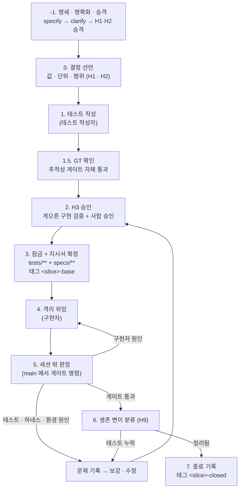

# 슬라이스 생명주기

슬라이스 = 한 번에 구현 · 판정 · 병합하는 수직 한 조각. 슬라이스 통과는 **병합 가능**을 뜻하고, 릴리스는 전체 게이트 통과가 기준이다. 슬라이스 판정은 **그 슬라이스를 닫은 시점의 커밋에서만** 의미가 있다: 닫힌 슬라이스의 테스트 선택을 이후 코드에 다시 적용해 커버리지 · 변이가 떨어지는 것은 결함이 아니다 (공유 파일이 이후 슬라이스에서 커지므로. 선행 실험 문제 #21 · 결정 D-28).

> 단일 CLI(`harness gate`, `harness lock`, `harness mark` …)는 아직 없다 (README 참고). 실제 명령(`python harness/run_gates.py`, `python harness/check_protected_paths.py --write-lock`, `python harness/mark.py`)으로 실행한다.

## 1. 흐름

## 2. 단계

| # | 단계 | 누가 | 하는 일 | 산출물 · 양식 |
|:---|:---|:---|:---|:---|
| -1 | 명세 · 명확화 · 승격 | spec_author → 사람 (H1 · H2) | `specify` 로 명세 초안(Invariants, Boundary tables) 작성 → `clarify` 로 모호성 해소 → 가정 · 답변을 사람(H1 · H2)이 `D-##` 또는 `H#` 로 승격 | `specs/<기능>/spec.md`, `templates/sdd/` |
| 0 | 결정 선언 | 사람 (H1 · H2) | 슬라이스가 다루는 모든 입력 · 설정값의 단위 · 범위 · 정밀도 · 검증 위치를 선언(C-A3). 슬라이스 범위(파일 목록, 측정 대상)와 역할 배정 | 결정 기록 (형식 C), 슬라이스 정의, 배정 |
| 1 | 테스트 작성 | 테스트 작성자 | 선언된 범위로 테스트 작성 · 보강. 모듈 머리말에 지키는 ID 인용 | `templates/test-skeletons/`, 설계 근거 `templates/test-design/01 ~ 09` |
| 1.5 | 추적성 확인 (GT) | 테스트 작성자 | 테스트 작성자 쪽에서 추적성 게이트(`traceability.py`) 자체 통과 확인 (양방향 추적성, `[NEEDS CLARIFICATION]` 0건, 가정 · 명확화 승격) | 게이트 GT 결과, `harness/traceability.py` |
| 2 | H3 승인 | 테스트 작성자 → 사람 | 게으른 구현 검증 → 승인 자료 → 열린 질문을 D-xx로 → 승인 | `templates/test-design/10`, `templates/h3-approval.md`, `templates/checklist.md` |
| 3 | 잠금 | 사람 승인 → lead 실행 | H3 승인 직후 · 위임 전에 lead 가 `python harness/check_protected_paths.py --write-lock` (테스트와 명세가 바뀌었을 때만: `locked = ["tests/**", "specs/**"]`). 지시서 확정 · 커밋 · 기준 태그 | `templates/work-order-implementer.md`, 태그 `<slice>-base` |
| 4 | 격리 위임 | lead → 구현자 | 필요한 파일만 격리 저장소로, 아무 에이전트 도구로 위임, 쓰기 허용 경로의 diff만 회수 | `docs/isolated-delegation.md` |
| 5 | 세션 밖 판정 | lead (실행만) | main에서 게이트 명령. 판정은 명령의 결과뿐이다. 실패를 원인별로 나눈다 (§4) | 판정 보고 · 실행 이력 |
| 6 | 생존 변이 분류 | 변이 분류자 → 사람 (H9) | 생존 변이를 유형별로 처리 (§5) | 문제 기록, 결정 기록 |
| 7 | 종료 | lead (H9 대상이 있으면 사람) | 게이트 통과이고 사람 판정이 필요한 생존 변이가 없으면 lead 가 종료 기록 작성 · 커밋 · 종료 태그. 있으면 사람이 H9 뒤 종료 | `templates/slice-closure.md`, 태그 `<slice>-closed` |
| (선택) | 레드팀 | 레드팀 (테스트 작성자와 다른 계열) | 위험 도메인(돈 · 동시성 · 개인정보 · 외부 시스템)에서 게이트를 통과하는 명세 위반 구현을 시도 | 검토 보고서, 문제 기록 |

## 3. 게이트 (순서가 의미를 가진다: 싸고 빠른 검사 → 비싸고 느린 검사)

| ID | 게이트 | 왜 | 값의 소유 |
|:---|:---|:---|:---|
| GA | 역할 배정 제약 | 분리 제약을 어긴 배정이면 뒤의 판정이 독립적이지 않다 | 배정 = 프로젝트 |
| G0 | 보호 경로 · 우회 패턴 · 테스트 잠금 | 구현자가 테스트나 게이트를 고쳐 통과하는 경로를 먼저 막는다 | 우회 패턴 = 어댑터, 보호 경로 = 프로젝트 |
| GT | 요구 추적성 (SDD) | 명세의 요구마다 지키는 테스트가 있고, 테스트가 인용한 ID 가 명세 · 결정에 있으며, 명세의 추측(가정 · 명확화 · NEEDS CLARIFICATION)이 사람 결정 없이 테스트로 내려가지 않았는지 | 명세 · 결정 = 프로젝트 |
| GC | 헌법 = 설정 | 에이전트가 읽는 헌법(.specify/memory/constitution.md)이 판정 설정(config/*.toml)과 다르면, 에이전트는 자기를 판정하는 규칙을 모른 채 일한다 (HD-04) | 설정 = 프로젝트 |
| G1 | 구조 규칙 (레이어 · 금지 호출 · 테스트 도구 import 금지) | 구조가 무너지면 Fake 기반 테스트의 전제가 무너진다 | 레이어 규칙 = 프로젝트 |
| G2 | 단위 · 성질 · 유스케이스 · 계약(Fake) | 불변식 대부분을 빠르게 검사 | — |
| G3 | 분기 커버리지 | "실행되지 않은 코드"를 찾는 용도로만 | 임계값 · 대상 = 프로젝트 |
| G4 | 인수 시나리오 | 단위 테스트가 놓친 조립 오류 | — |
| G5 | 통합 (실제 자원 계약 · 동시성) | Fake와 실제가 같은지, 구조적 보증이 있는지 | 필요한 환경 = 프로젝트 |
| G6 | 변이 점수 | 테스트가 결함을 실제로 잡는지 | 임계값 · 등가 규칙 켜기 = 프로젝트 |
| G7 | 정적 품질 (복잡도 · 타입 · 보안 스캔) | 다음 작업자의 비용을 지킨다 | 상한 · 대상 = 프로젝트 |

공통 장치(하네스): 이전 산출물 삭제, 게이트 하위 프로세스의 환경 변수 강제(서비스 환경과 **다른** 값), 게이트 단위 시간 제한, 슬라이스 범위 밖 게이트의 명시적 SKIP.

## 4. 판정 실패의 귀속

| 원인 | 판단 근거 | 처리 | 구현자 KPI |
|:---|:---|:---|:---|
| 구현자 | 잠긴 테스트 · 지시서대로면 통과 가능했다 | 실패한 게이트 이름과 메시지만 구현자에게 전달 (`max_rounds` 안에서) | 포함 |
| 테스트 누락 | 명세를 지키는 다른 구현과 구별하지 못하거나, 막아야 할 구현을 통과시킴 | 테스트 보강 → H3 재승인 → 재잠금 → 재판정. **구현자에게 돌려보내지 않는다** | 제외 |
| 하네스 | 게이트 · 실행기 · 측정 범위 결함 | 문제 기록 → 사람 결정(H10) → 수정 → 재판정 | 제외 |
| 환경 | OS · 도구 · 위임 도구 | 문제 기록 → 우회 · 수정 | 제외 |

## 5. 생존 변이 분류 (mutation triage)

| 유형 | 판단 | 처리 |
|:---|:---|:---|
| 테스트 누락 | 변이가 명세상 다른 동작인데 테스트가 구별하지 못함 | 테스트 보강(예: 07 속성 보존, 03 맞닿는 경계) → H3 재승인 · 재잠금 |
| 등가 의심 | 두 프로그램의 동작이 같아 보임 | 변이 분류자(테스트 작성자와 다른 계열)가 분류 → 사람이 판정(H9) |
| 반복되는 등가 유형 | 같은 유형을 사람이 매번 같은 답으로 판정 | 결정(D-xx)으로 **등가 규칙**을 정하고 하네스가 기계로 적용. 제외한 변이는 보고서에 하나씩 적는다. 보수적으로(확실한 형태만) |
| 실행 환경 의존 | 실행 기계의 환경이 서비스 환경과 같아서 결과가 같았음 | 게이트 환경을 서비스와 다른 값으로 고정 (H10) |
| 동작으로 구별 불가 | 다른 결정 때문에 결과가 달라지는 입력이 정의역에 없음 | "잡지 않는 것"으로 기록. 원칙 위반이면 검토자 · 레드팀의 영역 |

## 6. git 체크포인트

| 태그 | 시점 | 메시지 (한 줄, "무엇이 증명되었나") |
|:---|:---|:---|
| `<slice>-base` | 테스트 잠금 + 지시서 확정 커밋 | 예: "테스트 <N>건 잠금, 지시서 확정" |
| `<slice>-closed` | 종료 기록 커밋 | 예: "첫 실행 통과, 하네스 수정 없음" |

| 규칙 | 내용 |
|:---|:---|
| annotated | `git tag -a`. 경량 태그를 쓰지 않는다 |
| 누가 | 커밋 · 로컬 태그는 lead. 기준 태그는 사람의 H3 승인 직후 · 위임 전에만 단다. **기존 태그를 옮기거나 지우지 않는다**(기준 태그는 G0 판정의 기준점). push · 병합은 사람 지시로만 |
| 기준 태그 = 판정 기준 | 게이트의 `--base`와 리드타임 시작점이 기준 태그다. 지시서 확정 뒤 하네스 · 보고서 커밋이 쌓여도 기준은 움직이지 않는다 |
| 재잠금 시 | 테스트를 고쳐 재잠금하면 새 기준 커밋에서 판정한다. 기준 태그를 옮기지 말고 경과를 종료 기록에 적는다 |
| 실패 · 되돌림 | 태그를 달지 않는다. 문제 기록에 남긴다 |
| 단계 중 판정 변화 | 같은 입력의 판정이 단계 중에 바뀌면 그 단계를 닫지 않는다 |
| 이름 규칙 | 태그 패턴은 프로젝트 설정(KPI 집계가 읽는다) |
| 슬라이스 초안 | `python harness/new_slice.py --slice <ID> --title <제목> --files <a,b> --tests <t> --risk <low|medium|high> [--depends <ID>]` 는 slices · 배정 블록 · 지시서 · 자동 승인 참조 초안을 출력만 한다(`--write` 면 `work_orders/` · `reports/` 에 파일, 덮어쓰기 없음). 설정 반영은 사람(H10). 게이트 덮어쓰기(`override.*`)는 직접 채운다 |
| 문서 최신화 | 점검 = `doc_auditor`(Codex, `adapters/tools/codex_audit.py` 로 읽기 전용 고정 · 실행 뒤 작업 사본 변경 0 확인), 편집 = `doc_editor`(다른 계열, `docs/HANDOFF.md` · `reports/**` 만, `run_gates.py --role doc_editor --only G0`), 검증 = lead diff + 상태 줄 검사. 절차: `docs/isolated-delegation.md` §5 |
| 증거 검사 | 위임 전 `python harness/step.py --slice <ID> --check delegate`, 종료 태그 전 `--check close`. 종료 1 이면 막힘 코드(D2 ~ D6 · C1 ~ C7)를 해소한 뒤 진행한다. 현재 단계 · 다음 일은 `--check` 없이 실행. 자동 승인(H3)은 `python harness/mark.py auto-approve <D-##> --wo <ID> --gt pass --lazy-caught N/M --residual-defects 0 --base-types unbounded,reject-preserve --by lead` 로 기록한다(조건 미달이면 사람 H3). 종료 기록 초안은 `python harness/step.py --slice <ID> --closure-draft`(stdout 만 · 미판정, 서술 · H9 칸은 비움 · 파일 · 태그를 쓰지 않음). 단계별 시각은 `python harness/kpi.py --timing` → `reports/tdd-timing.md`(kpi.md 는 그대로), additive 자동 승인: `python harness/mark.py auto-approve additive --wo <ID> --kind mutant-kill|regression --base <테스트 추가 직전 커밋 40자> --review-note "<무엇을 단언하는지>" --by lead`. 조건: 기준..HEAD 가 test_author 허용 경로의 새 일반 파일 추가뿐이고 그중 하나 이상이 잠금 범위 테스트, 잠금 파일 · 잠긴 테스트 그대로, 작업 트리 깨끗, 같은 기준으로 실행한 test_author 전체 게이트 통과 증거. mutant-kill 은 기준 커밋 전체 실행보다 미검출 변이가 줄어야 한다. 위험도 high 는 제외하며, 하나라도 아니면 사람 H3. 받아들인 위험: 현재 코드에서 통과하는 테스트는 버그를 포함한 현재 동작을 굳힐 수 있고 regression 은 빈 테스트를 기계로 막지 못하므로 리드가 `--review-note` 에 검토 내용을 남긴다. 자동 승인 적용 현황은 기본 `kpi.py` 보고서의 절 |
